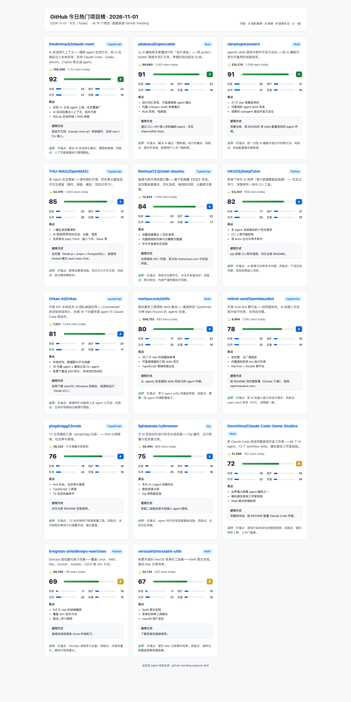

# GitHub Trending Analyzer · GitHub 热门项目分析

一个可复用的 AI Agent Skill：自动抓取 GitHub Trending 趋势榜，逐个读取仓库 README 与元数据，按四维评分输出带评级的项目清单，并生成可视化网页报告（项目卡片 + 评分柱状图）。每天帮你省下手动翻榜的时间。

## 效果预览



*上图：2026-11-01 今日榜实跑输出（14 个项目，卡片 + 四维评分柱状图，按总分降序）*

## 功能特性

- 📈 自动抓取 GitHub 今日 / 本周 / 本月趋势榜，支持按语言过滤
- 📖 自动读取各仓库 README 与元数据（最近提交、许可证、Issues）
- ⭐ 四维评分：受欢迎度(25) / 维护活跃度(25) / 实用可应用性(30) / 技术栈质量(20)，总分 100
- 🏅 评级：S(≥90) / A(75-89) / B(60-74) / C(<60)，附每条点评
- 🖥️ 自动生成可视化 HTML 报告：项目卡片 + 四维评分柱状图，按总分降序
- ✅ 数据全部来自真实抓取，禁止编造

## 目录结构

```
github-trending-analyzer/
├── SKILL.md                  # 主指令：5 步工作流 + 输入参数 + 输出规范
├── references/
│   └── scoring.md            # 四维评分细则
└── assets/
    └── template.html         # 可视化报告模板
```

## 安装

本 Skill 适配支持 Agent Skills 的平台，无需安装依赖、无需 API Key、无需登录：

| 平台 | 安装位置 |
|---|---|
| 豆包工作 | `workspace/.user_skills/` |
| Claude Code | `~/.claude/skills/` |

将 `github-trending-analyzer` 整个文件夹放入上述技能目录即可。

## 使用方法

对 AI Agent 直接说：

- 「分析今日 GitHub 热门项目」
- 「本周 Python 热榜有哪些好项目」
- 「帮我整理本月 GitHub 趋势榜，输出评分报告」

**输入参数**

| 参数 | 取值 | 默认 |
|---|---|---|
| 时间范围 | today / weekly / monthly | today |
| 语言过滤 | 任意语言（如 Python、TypeScript） | 全部语言 |
| 数量上限 | 数字 | 全部在榜项目 |

## 评分细则

| 维度 | 分值 | 说明 |
|---|---|---|
| 受欢迎度 | 25 | 周期新增 Star、总 Star |
| 维护活跃度 | 25 | 最近提交 / Release、Issue 响应 |
| 实用可应用性 | 30 | 用途明确、文档齐全、可落地 |
| 技术栈质量 | 20 | 技术主流性、工程规范 |

## 输出

1. **对话内清单**：按总分排序，每条含基本信息、简介、四维得分、评级、亮点、使用方式、点评
2. **HTML 报告**：命名规范 `github-trending-YYYY-MM-DD-{today|weekly|monthly}.html`，项目卡片 + 评分柱状图

## 注意事项

- 抓取 GitHub 公开页面即可，无需登录
- 个别仓库页面 / API 可能受访问限制（robots、rate limit），此时改用 GitHub 搜索页兜底，如实标注数据缺口，**禁止编造**
- 周期性运行建议使用默认参数（今日榜、全语言）

## License

MIT，详见 [LICENSE](LICENSE) 文件。
