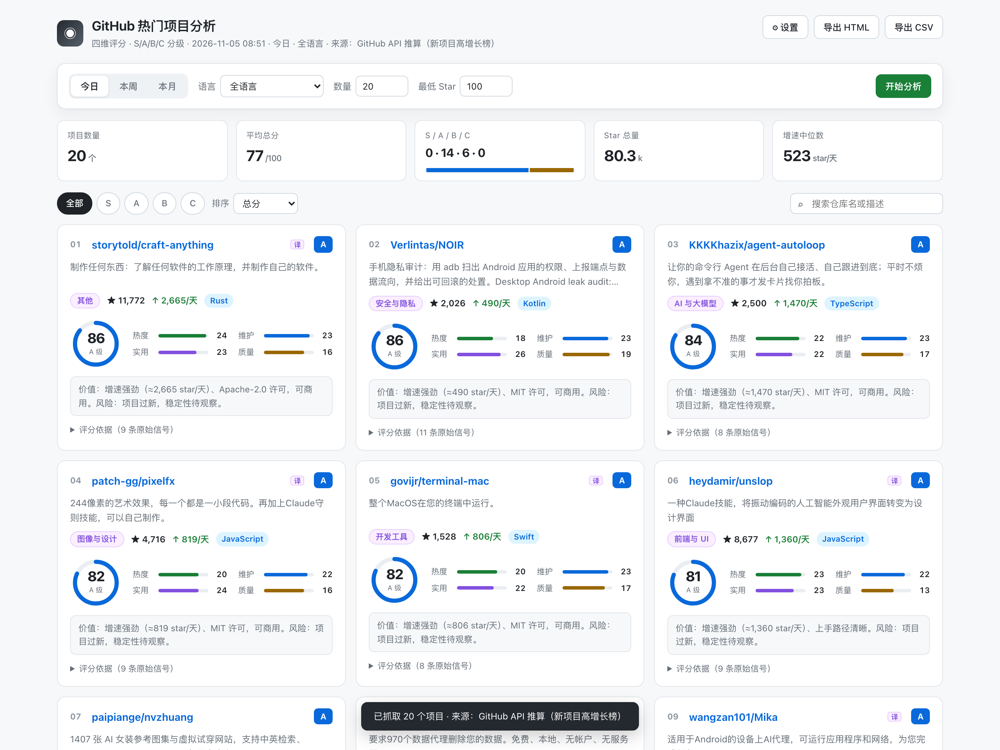

# GitHub 趋势分析 · 桌面版

把 `github-trending-analyzer` skill 的分析能力做成本地可视化应用：选周期 → 抓数据 → 四维打分 → 卡片看板 → 导出报告。

和 skill 的分工：**skill 负责深读**（真实打开仓库页读 README、判断项目价值、写个性化点评），**本应用负责快筛**（秒级出榜、可复算、可导出）。需要更细的判断时，把应用导出的 CSV 丢回对话，让 skill 在候选清单上做深读。



## 一、安装与运行

需要 Python 3.9+。

```bash
cd app
python3 -m venv .venv
source .venv/bin/activate        # Windows: .venv\Scripts\activate
pip install -r requirements.txt

python app.py --window           # 原生窗口（pywebview）
python app.py                    # 仅起服务，浏览器打开 http://127.0.0.1:8760
```

`requirements.txt` 只有三个依赖：flask、requests、pywebview（不需要 electron、不需要 node）。

## 二、界面怎么用

| 位置 | 作用 |
|---|---|
| 今日 / 本周 / 本月 | 时间窗口。窗口越大，候选池越宽（今日按 7 天取样、本周 28 天、本月 120 天） |
| 语言 | 按主语言过滤，默认全语言 |
| 数量 | 输出条数，3–50，默认 20 |
| 最低 Star | 候选门槛，默认 100。拉不到数据时先降到 30 |
| 开始分析 | 抓取 + 打分，单次约 8–15 秒 |
| 评级 chips | 只看 S / A / B / C |
| 排序 | 总分 / Star 增速 / 总 Star / 最近提交 |
| 搜索 | 按仓库名或描述过滤 |
| 分类标签 | 卡片左侧紫色标签，规则识别为「视频与音频 / 网络爬虫与采集 / AI 与大模型 / 开发工具 / 图像与设计 / 前端与 UI / 后端与基础设施 / 安全与隐私 / 自动化与效率 / 系统与运维 / 游戏与图形 / 移动与跨端 / 区块链与 Web3 / 学习资源 / 数据与分析」，识别不出的归「其他」 |
| 中文简介 | 简介默认显示中文机器翻译；右上角「译」标记表示该条为译文，鼠标悬停可看英文原文 |
| 评分依据 | 展开每个项目 6–11 条原始信号，可核对分数怎么来的 |
| 导出 HTML / CSV | 生成独立报告文件，HTML 与 skill 报告模板同风格；CSV 含分类与中英简介两列 |

## 三、评分口径（与 skill 一致）

- 受欢迎度 25：Star 增速（按天）+ 总 Star 分档
- 维护活跃度 25：最近提交距今时间，归档 / Issue 过多扣分
- 实用可应用性 30：README 完整度、安装命令、示例代码块、主页、采用度
- 技术栈质量 20：许可证类型、是否主流语言、CI 配置、工程体量

分级：90+ S / 75–89 A / 60–74 B / <60 C。

**这是规则打分，不是 LLM 判断。** 每个分数都能在「评分依据」里看到对应信号；它适合快速筛，不替代逐仓库读 README 的深读。

## 四、数据源与方法

### 榜单来源

优先抓 `https://github.com/trending` 官方页（能拿到真实的「今日新增 Star」）。若网络访问不了 github.com 网页，会自动降级为 **GitHub API 推算**：

- 取「最近 X 天内创建、Star 数靠前」的仓库，用 `Star ÷ 创建天数` 作为增速；
- 结果页顶部会明确标注来源，不会把推算说成官方数据。

两种模式的差别：官方页能覆盖「老仓库突然爆火」；API 推算只覆盖「新项目高增长」。

### README 与中文简介的取数通道

| 内容 | 通道 | 说明 |
|---|---|---|
| README 正文 | ① 本地缓存（6 小时）② raw.githubusercontent ③ GitHub API `/readme` | 部分网络下 raw CDN 会超时，此时自动退到第 ③ 条，**每仓库消耗 1 次核心配额** |
| 中文简介 | MyMemory 公共翻译接口 | Google 翻译在部分网络不可达、有道需鉴权，MyMemory 可直连；译文缓存到 `cache/translations.json`，同一句不重复请求 |

README 覆盖率低于 60% 时，界面顶部会提示「实用性分数偏低」——这时分数偏保守，不是项目变差了。

## 五、限流与 Token

未登录状态：搜索接口 10 次/分钟，核心接口 60 次/小时。单次分析 = 1 次搜索 + 最多 N 次 README（N 为输出条数，命中缓存则为 0）。

**因此连续分析不同榜单 3 次左右就可能耗尽每小时 60 次配额**，表现为 README 覆盖率下降、实用性分数偏低。要长期高频使用就填 Token：右上「⚙ 设置」填入 GitHub Personal Access Token（只读即可），额度升到 5000 次/小时。Token 只存在本地浏览器 localStorage，不落盘、不外传。

## 六、常见问题

**「分析失败：抓取失败」** — 先确认能否访问 api.github.com；再试把「最低 Star」降到 30。

**结果全是 A / B，没有 S** — 规则口径下 S 需要四维几乎全满（例如 1000+ star/天、近期提交、README 齐全、宽松许可），属正常现象，不是 bug。

**分类不准** — 分类是关键词规则（仓库名 / 描述 / topics / 中文译名），不是模型判断。描述模糊的通用工具会落到「其他」。要更准就改 `core.py` 里的 `CATEGORY_RULES`。

**中文简介读起来别扭** — 机器翻译，专有名词已做回正（Claude / OpenAI / GitHub 等），技术黑话仍可能有偏差。悬停可看英文原文；同一句译文会被缓存，改不了就删 `cache/translations.json` 重跑。

**简介全变英文了** — MyMemory 每日免费额度用完了（匿名约 5000 字符/天），界面顶部会提示「翻译额度已用尽」，次日自动恢复。

## 七、目录结构

```
app/
├── app.py              Flask 服务 + 导出接口
├── core.py             抓取、分类、打分、点评生成
├── translate.py        简介中英翻译（含缓存与额度保护）
├── templates/
│   ├── index.html      看板界面
│   └── report.html     导出报告模板
├── assets/
│   ├── icon.svg        图标源文件
│   └── appicon.icns    macOS 图标
├── requirements.txt
└── README.md
```

运行后会生成 `cache/`（README 与译文缓存），不入版本库。

## 八、实现要点

- 榜单、元数据、README、翻译四条链路都有降级路径，任一环节不可用时报错或降级，不静默造数据；
- README 抓取并行 + 总时限，慢请求不拖累整体；
- 打分前先按 API 元数据粗排，只给入选项目抓 README，控制配额与耗时；
- 翻译与 README 均带磁盘缓存，重复分析不重复请求。

## 九、License

MIT，见仓库根目录 LICENSE。
